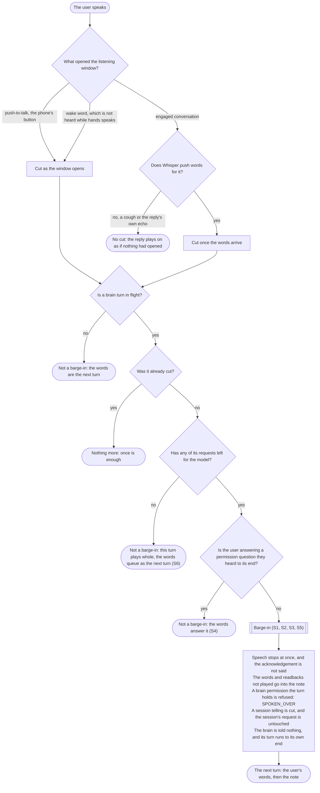
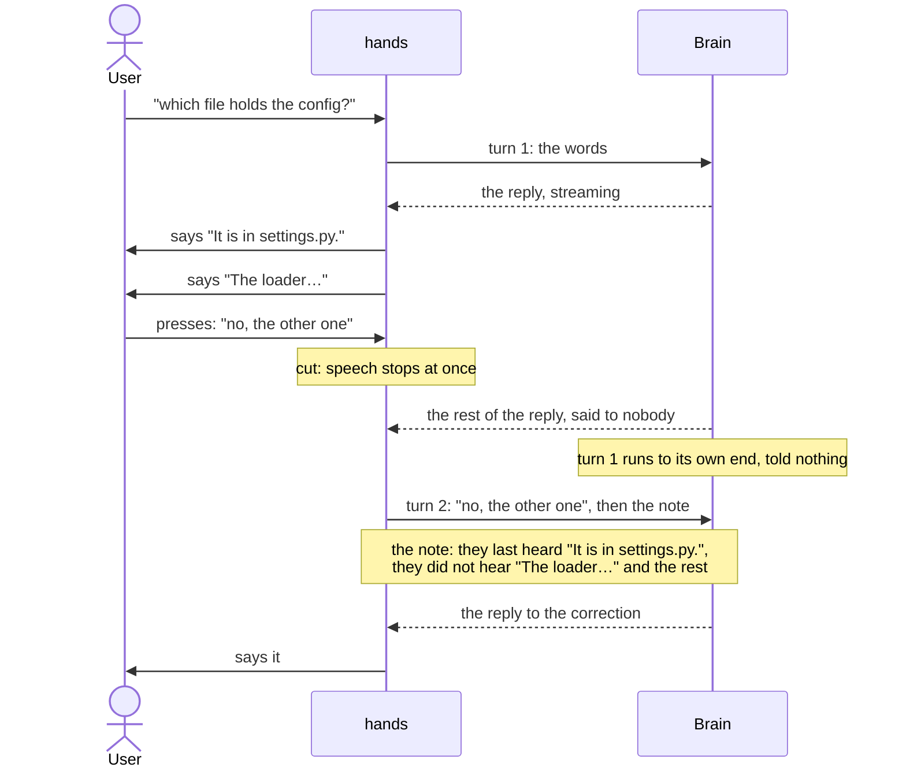
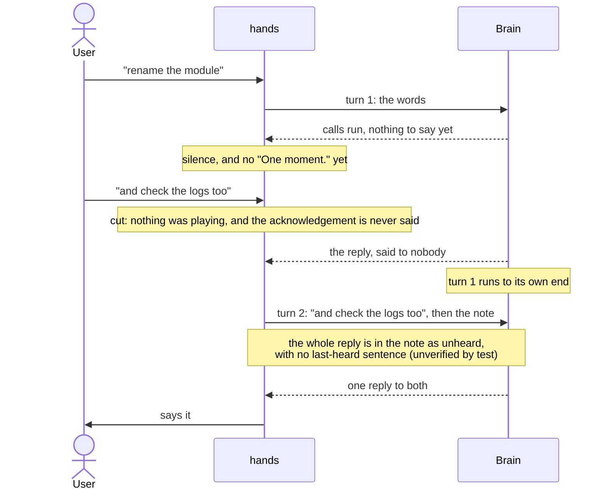
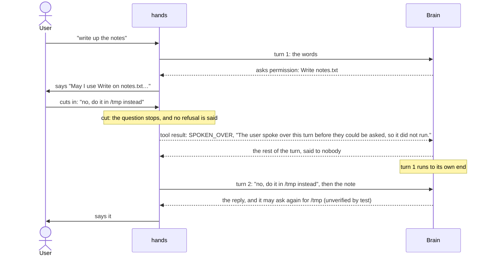
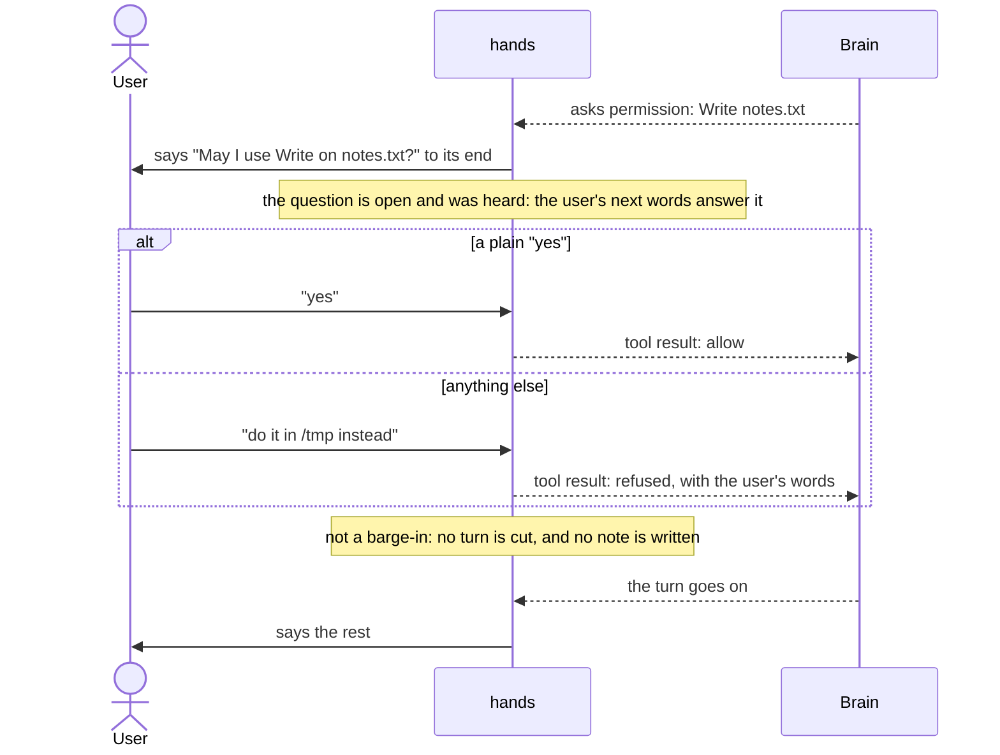
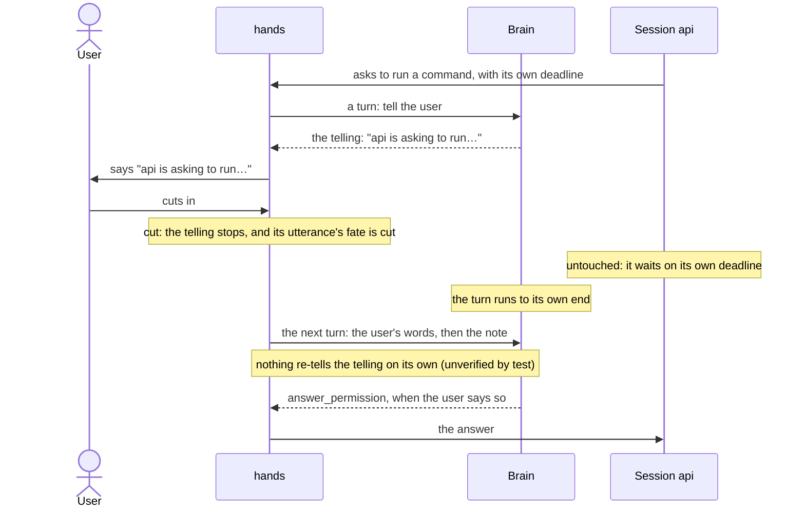
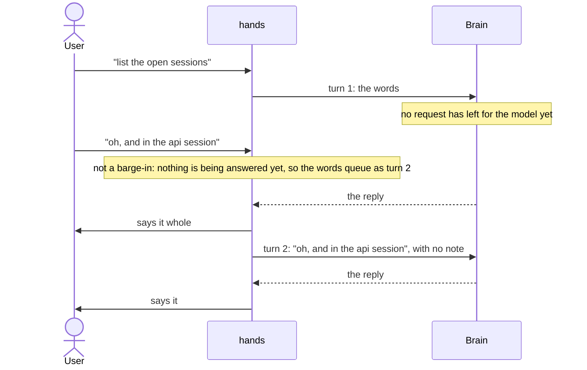

# Barge-in

A barge-in is the user speaking while the brain's turn is in flight: a reply being read, a call
running in silence, a permission question half-said. This document is that flow as a decision tree
and the two decision tables behind it, six scenarios each drawn as a sequence diagram, a rubric of
five criteria, and the run that scores a build against them and turns each failed cell into a
ticket. It is re-checked on every change to the flow. Hands' own words for the flow are mapped to
the standard voice-interface terms first, so an engineer or designer new to hands can read the tree
and the scenarios before the code. The diagrams are Mermaid, which GitHub renders in place: a
flowchart for the tree, UML sequence diagrams for the scenarios.

## The goal

The user, 2026-10-17:

> I need to be able to say a short correction or add a piece of information without totally
> derailing the discussion and, and breaking the agent's ability to respond coherently. Whatever we
> can do that makes this work is what we should do.

> The previous solution of pressing escape was incredibly disruptive. It not only disrupted the
> existing pattern, it also removed that context from the agent's memory. which caused data loss,
> as it forgot, scoped queries.

> Anything that is cut off is not discarded out of hand, it remains in queue/stack for the brain.
> On the brain's next turn, it can decide to discard as no longer relevant or it can aggregate that
> question/info with related info, or it can decide to bring it up, or any other option. If
> something is interrupted it shouldn't disappear without the brain's input, that is a form of
> amnesia and leads to incoherency and degenerate intelligence.

## In standard terms

Hands' words for the flow are below, each beside its standard voice-interface term. The cut rule is
the barge-in rule of [VoiceXML 2.0](https://www.w3.org/TR/voicexml20/), the W3C standard for voice
dialogs, whose `<prompt>` carries `bargein` and `bargeintype`.

| Here | In standard terms |
|---|---|
| the hold | the listening window: the time the microphone is the user's, opened by push-to-talk, a wake word, or an engaged conversation (open mic) |
| the edge that opened the hold | the activation mode: push-to-talk or the phone's button, the wake word, engaged conversation |
| the cut | barge-in: the user's speech stops what the system is saying (VoiceXML `bargein="true"`) |
| a hold the hand opened cuts as it opens | VoiceXML's DTMF barge-in: a key press stops the prompt at once, with nothing to recognize |
| a hold the wake word opened cuts as it opens | the wake word is VoiceXML's hotword, a recognized phrase rather than any sound; but hands' detector is fed silence while hands speaks, so it cuts only a turn working in silence, never a reading |
| a hold engaged conversation opened cuts once Whisper pushes words | nearest VoiceXML `bargeintype="speech"`, which stops the prompt on detected speech; hands waits for transcribed words rather than voice energy, so a cough does not cut |
| the brain's turn | a dialog turn: one message to the agent and everything it says and does in reply |
| a session telling | a proactive notification: hands speaking about a Claude Code session unprompted |
| the note | context carry-over: what the next turn is told about the one cut off |
| `resume`, `skip`, `repeat` | playback controls over what was cut off |

## The decision tree

Diamonds decide; rounded boxes end a path and name the scenario below that exercises it. The two
tables under the tree carry the reason for each branch and the code and test that hold it.

## Two decisions

**1. The cut.** The edge that opened the hold decides when the turn cuts (`voice/turnstart.py:1–15`;
the mechanism, `docs/architecture.md:1672–1696`). The cut is Pipecat's `InterruptionFrame`.

| The hold was opened by | It cuts |
|---|---|
| the user's hand: the held key, the phone's button | as it opens |
| the wake word | as it opens; the detector is fed silence while hands speaks (`voice/wake.py:6`, `136–140`), so it opens no hold on a reading, only on a turn working in silence |
| engaged conversation | once Whisper pushes words for it |
| a hold that holds no words | nothing, so nothing has to be undone |

**2. Barge-in on the brain's turn.** `_barge_in`, `brain/stage.py:594–609`, decides whether a cut is
a barge-in. The guard on line 599 says no in four cases:

| A cut is not a barge-in when | Because |
|---|---|
| no brain turn is in flight | there is nothing to cut off |
| the turn was already cut | once is enough |
| none of the turn's requests has left for the model | the brain has not started answering; the words queue as the next turn and this one plays whole when it comes |
| the user is answering a permission question they heard to its end (`asking()`, `brain/stage.py:243–245`) | words over an open heard question are its answer, not a turn (`brain/stage.py:315–319`) |

Otherwise it is a barge-in, and the next table says what becomes of each thing it cuts off. The
brain is told nothing and nothing is typed into it: `Asking`, the protocol the stage holds the brain
by (`brain/stage.py:81–88`), has `session` and `ask` and no interrupt, and the frame's handler at
`brain/stage.py:340–352` lets the turn run to its own end.

## What a barge-in does to each thing it can cut off

| Cut off | What happens | What the brain holds afterwards | Where to check |
|---|---|---|---|
| the brain's words after the cut | not played; quoted in the note | its own words, in its history; the note | `brain/stage.py:466`, `735–751`; `test_a_sentence_on_its_way_to_the_speaker_when_the_user_spoke_over_it_is_told_unheard_whole`, `test_a_barge_in_mid_reply_stops_it_being_said_and_the_brains_turn_runs_on_to_its_end` |
| a call's readback | not said; quoted in the note | the call's result; the note | `brain/stage.py:466`; `test_a_readback_of_a_turn_the_user_spoke_over_is_told_the_brain_never_said` |
| a brain permission question: playing, queued behind another, or raised after the cut | settled `Deny(SPOKEN_OVER)`; never said again | the denial text as the tool result; it may re-ask next turn (unverified by test) | `brain/stage.py:539–541`, `606–607`; `brain/process.py:95`; `test_a_permission_held_after_the_user_spoke_over_its_turn_is_refused_and_never_asked`, `test_a_yes_said_before_the_question_has_played_allows_nothing_and_the_brain_is_told_it_went_unheard`, `test_a_refusal_of_a_question_never_heard_to_its_end_is_not_said` |
| the refusal lines hands owed the user (`unacknowledged`) | cleared | the refusals it received | `brain/stage.py:609`; unverified by test |
| the acknowledgement | not said | nothing | `brain/stage.py:239–241`, `651–657`; `test_a_turn_the_user_spoke_over_while_its_call_runs_is_not_acknowledged` |
| a session telling | not played; quoted in the note; its utterance's fate is `cut` | the note; hands does not re-tell it (unverified by test) | `voice/utterance.py:146–160`; `core/pending.py:130–140`; `test_a_barge_in_that_stops_the_telling_leads_nothing_more_on` |
| a session's permission, question or plan | untouched; it waits on its own deadline | unchanged | `voice/tools.py:1365–1409`; `sessions/hookconfig.py:13–17`; unverified by test |
| a reply that breaks after the cut; a turn that fails after it | the note says it was heard by nobody; the note adds only that it failed | the note | `test_a_reply_that_breaks_after_the_user_spoke_over_the_turn_is_told_the_brain_as_heard_by_nobody`, `test_a_turn_spoken_over_that_then_fails_tells_the_next_what_the_user_heard_and_that_it_failed` |

The user, 2026-10-17, on the third and seventh rows: "Brain permissions, I understand we are blocked
if stuck at a prompt so this is acceptable. The brain can re-ask. Session permissions should not be
automatically refused."

## What the brain receives

Nothing at the cut. At the turn's end the note is built and recorded (`brain/stage.py:459–467`;
`_spoken_over`, `735–751`), and it goes after the user's next words (`_notes`, `brain/stage.py:432`;
asserted by `test_a_sentence_on_its_way_to_the_speaker_when_the_user_spoke_over_it_is_told_unheard_whole`
and `test_a_readback_of_a_turn_the_user_spoke_over_is_told_the_brain_never_said`). Its shape:

> [hands] The user spoke over you, and nothing more was said aloud. They last heard "<last sentence
> played to its end>". They did not hear: "<rest of the reading cut off> <the turn's words never
> handed to the speaker> <each call's readback>".

"They last heard" is absent when no sentence had played to its end; "They did not hear" is absent
when nothing was unheard. A brain permission the turn held gets `SPOKEN_OVER` as its tool result
(`brain/process.py:95`):

> The user spoke over this turn before they could be asked, so it did not run.

The brain reads the note under this instruction, `voice/intermediary_instruction.py:124`:

> The user cuts you off often. When they do, the [hands] note that comes with their next words says
> what they last heard and what they did not hear, and what they did not hear is what they missed.
> Whether you go back to it, and how, is your judgment, from why they cut in. Hands keeps what was
> said and where it stopped, so when they say "go back to what you were saying", "where were we",
> or "carry on", call resume; "skip that" or "next", skip; "say that again" or "what was that",
> repeat. Your memory of what you said is not what they heard, so what you tell them they missed
> comes from that note, never from your memory.

## Scenarios

A live check reads the `voice.turn` event, one per brain turn (`brain/stage.py:504–520`; the event
and the note, `docs/architecture.md:1066–1086`): `asked`, `text`, `interrupted`, `spoken_over`,
`acknowledged`, `refused`, `refusals`, `queued_ms` (how long your words waited behind the turn
before them) and `waited_ms` (from the end of your words to the turn's first word; null when none
was said); and the `utterance` event's `fate` (`played`, `cut`, `silent`, `noted`, `dropped`) for a
session telling (`voice/utterance.py:84–91`; the floor and utterances, `docs/architecture.md:392–395`).
The brain's history is Claude Code's transcript for its conversation,
`<brain config dir>/projects/*/<session>.jsonl`, found by `conversation`, `brain/process.py:185–197`.

### S1 — A correction while hands is mid-reply

- You: hands is reading its answer; you press and say "no, the other one".
- You hear: speech stops at once; silence while the brain's turn runs to its end; then its answer
  to "no, the other one".
- The brain's history holds: the whole reply it generated, the sentences you did not hear included;
  no rejected result, and your prompt intact (those two unverified by test).
- The next turn's `asked` carries: "no, the other one", then the note.
- Mechanics tests: `test_a_barge_in_mid_reply_stops_it_being_said_and_the_brains_turn_runs_on_to_its_end`,
  `test_a_sentence_on_its_way_to_the_speaker_when_the_user_spoke_over_it_is_told_unheard_whole`,
  `test_a_word_the_brain_streams_after_the_user_spoke_over_its_turn_is_no_wait_of_theirs`.
- Live check: the cut turn's `interrupted` and `spoken_over`; the next turn's `asked`, `text`,
  `queued_ms`, `waited_ms`.

### S2 — Added information while the brain works silently

- You: calls are running and nothing has been heard; you say "and check the logs too".
- You hear: nothing, and no "One moment.", until the next turn answers.
- The brain's history holds: the turn's reply, generated and never played (unverified by test).
- The next turn's `asked` carries: your words, then the note, whose "They did not hear" holds the
  whole reply, there being no last-heard sentence (unverified by test).
- Mechanics tests: `test_a_turn_the_user_spoke_over_while_its_call_runs_is_not_acknowledged`.
- Live check: the cut turn's `acknowledged` null and `interrupted` true; its `spoken_over` with no
  "They last heard".

### S3 — "No" over a permission question still playing

- You: "May I use Write on notes.txt…" is playing; you cut in "no, do it in /tmp instead".
- You hear: the question stops; silence; then the brain's answer.
- The brain's history holds: the permission's result is the `SPOKEN_OVER` text; its own words after
  it, unplayed.
- The next turn's `asked` carries: your words, then the note.
- Mechanics tests: `test_a_permission_held_after_the_user_spoke_over_its_turn_is_refused_and_never_asked`,
  `test_a_yes_said_before_the_question_has_played_allows_nothing_and_the_brain_is_told_it_went_unheard`,
  `test_a_refusal_of_a_question_never_heard_to_its_end_is_not_said`.
- Live check: the brain's transcript holds the `SPOKEN_OVER` text; the cut turn's `refused` is 0,
  nothing heard having been refused.

### S4 — An answer after the question finished playing (not a barge-in)

- You: the question has played to its end; you say "yes", or "do it in /tmp instead".
- You hear: hands goes on. A plain yes allows it; anything else refuses it and hands the brain your
  words.
- The brain's history holds: the permission's result, allow or your words.
- The next turn's `asked` carries: nothing new; your words were the answer, not a turn.
- Mechanics tests: `test_a_permission_the_brain_holds_is_asked_after_its_words_and_the_users_yes_lets_its_turn_go_on`,
  `test_anything_but_a_plain_yes_refuses_the_permission_and_hands_the_brain_the_users_words`,
  `test_permissions_held_at_once_are_asked_one_at_a_time_and_each_answer_goes_to_the_one_heard`.
- Live check: `interrupted` false; the turn's `refused` and `refusals`.

### S5 — A barge-in during a session telling

- You: hands is saying "api is asking to run …" or "api finished a turn, …"; you cut in.
- You hear: the telling stops.
- The brain's history holds: its turn for the telling, run to its end. The session's request is
  untouched and waits on its own deadline, and the brain answers it with `answer_permission` when
  you say so; nothing re-tells the telling on its own, the note being the path back (unverified by
  test).
- The next turn's `asked` carries: your words, then the note.
- Mechanics tests: `test_a_barge_in_that_stops_the_telling_leads_nothing_more_on` (the cut);
  `test_a_barge_in_the_telling_goes_on_through_leads_the_rest_of_it_on_again` (no request had left,
  so not a barge-in: the telling plays whole).
- Live check: the `utterance` event's `fate` is `cut`; the next turn's `asked`.

### S6 — Words before the brain has started answering (not a barge-in)

- You: you asked something and, before the brain's first request leaves, add "oh, and in the api
  session".
- You hear: this turn's reply plays whole when it comes; your addition is answered as the next turn.
- The brain's history holds: two turns.
- The next turn's `asked` carries: your addition, with no note.
- Mechanics tests: `test_a_barge_in_before_the_brain_has_sent_the_turn_stops_nothing_and_the_turn_is_answered`,
  `test_words_said_before_a_permission_is_asked_are_a_turn_of_their_own_and_never_part_of_its_answer`,
  `test_a_barge_in_the_telling_goes_on_through_leads_the_rest_of_it_on_again`.
- Live check: `interrupted` false on both turns; `queued_ms` on the second.

## The rubric

| | Criterion | In standard terms | Passes when | Read from |
|---|---|---|---|---|
| C1 | Hands stopped at once | barge-in latency | nothing of the turn played after your first word | your ear; the cut turn's `interrupted` true, and its `spoken_over` quoting as last heard the sentence you actually heard last |
| C2 | Nothing is lost | context retention | everything the brain said or did after the cut is in `spoken_over`, every word past the last-heard sentence and every readback, and the brain's transcript holds no rejected or interrupted result and your prompt intact | `text` against `spoken_over`; the brain's transcript file |
| C3 | The correction landed | task success | the next turn's `asked` is your words followed by the note, and its `text` acts on your words | the next turn's `asked`, `text` |
| C4 | The brain stayed coherent | conversational repair | it does not re-say what you heard, does not say you stopped or rejected anything, and does not carry on with what you said no to; what it tells you you missed comes from the note | the next turn's `text` read against `spoken_over` and the instruction at `voice/intermediary_instruction.py:124` |
| C5 | The correction was not slow | response latency | measured and recorded | the next turn's `queued_ms` and `waited_ms` |

## A run

1. Run. With hands running, perform S1–S6 by voice, in order, noting the clock time before the
   first. There is no text input to hands (`UserWords` is pushed only by transcription,
   `voice/conversation.py:81`), so a run needs a person at the microphone until the harness ticket
   in the epic lands.
2. Collect. `hands log -n <enough lines>` (`daemon/cli.py:162–163`) for the `voice.turn` and
   `utterance` events since that time, and the brain's transcript file. `hands recall <words>`
   (`daemon/cli.py:164`) finds a moment by the words said.
3. Score. An agent fills one row per scenario and criterion, `S# C# pass|fail <evidence pointer>`,
   the pointer being the event's time or id, or the transcript line. No narrative.
4. Record. The scorecard is a comment on the epic `promptctl-barge-in-duao`, "Barge-in: a short
   correction lands without derailing the brain": first line the date and the commit scored, then
   the rows.
5. File. Each failed cell becomes a ticket at the top of that epic, carrying the scenario, the
   criterion, and the evidence pointer.
6. Change. Per the rule below; the PR updates this document's tree, tables, scenario rows and
   diagrams with the flow.
7. Re-run. The change is scored by a run.

## Changing the flow

The user, 2026-10-17:

> Any change to this mechanism should evaluate the entire process/flow as a whole and make changes
> intentionally, rather than typing to patch a symptom.

A change to the flow updates the decision tree, the decision tables, and the scenario rows and
their diagrams in this document in the same PR, and is scored by a run.
